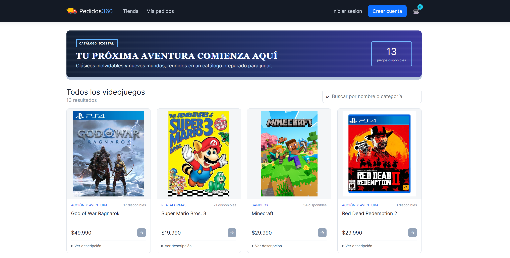
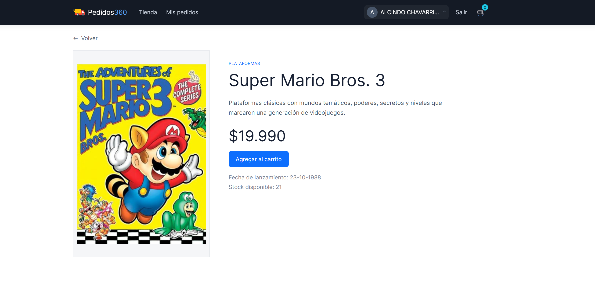
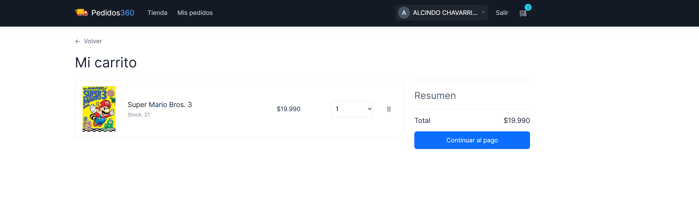
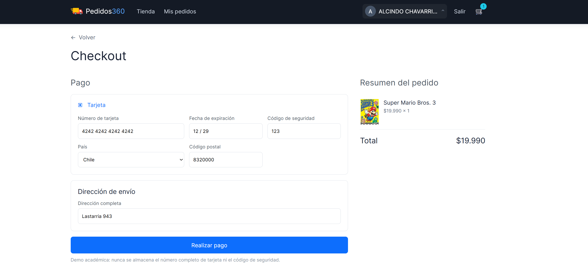
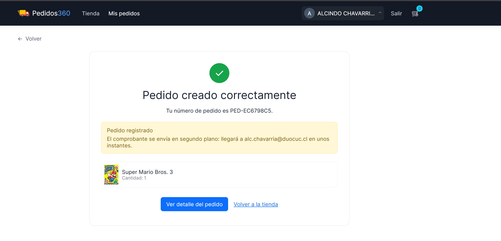
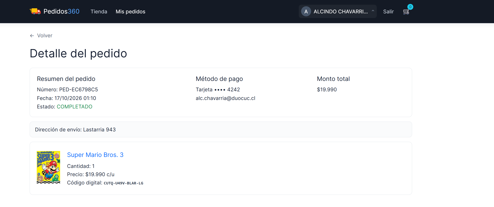

<div align="center">

# 🎮 Pedidos360

### Tienda digital de videojuegos · Arquitectura Cloud Native basada en microservicios

**Angular + Spring Boot + PostgreSQL + RabbitMQ + Docker | Microsoft Azure + AWS EC2**

### 🎨 Frontend


### ⚙️ Backend y datos


### 🐇 Mensajería, contenedores y nube


</div>

---

## 📖 Descripción del proyecto

**Pedidos360** es una aplicación web de comercio electrónico orientada a la venta de videojuegos. Ofrece catálogo, búsqueda, detalle de productos, carrito de compras, checkout con pago simulado, registro de pedidos, historial de compras y notificaciones por correo electrónico.

El proyecto utiliza un **frontend SPA en Angular** y un **backend de microservicios en Spring Boot**. La solución incorpora **RabbitMQ** para procesar eventos de compra de forma asíncrona y desacoplar el registro de envíos de las notificaciones. Su arquitectura de despliegue contempla el **frontend en Microsoft Azure** y el **backend en una instancia Amazon EC2 de AWS**.


El **API Gateway** centraliza el acceso a los servicios de dominio y la validación de tokens. Los microservicios cuentan con bases de datos PostgreSQL independientes y están preparados para su ejecución mediante Docker Compose.

## 🧩 Microservicios

| Componente | Puerto local | Responsabilidad |
|---|---:|---|
| `api-gateway` | 8080 | Punto de entrada, seguridad, CORS y enrutamiento |
| `msvc-usuario` | 8081 | Usuarios, registro e identidad |
| `msvc-producto` | 8082 | Productos, precios y control de stock |
| `msvc-carrito` | 8083 | Carrito de compras por usuario |
| `msvc-catalogo` | 8084 | Catálogo y contenido de la tienda |
| `msvc-pago` | 8085 | Checkout, pagos simulados, pedidos e historial |
| `msvc-envio` | 8086 | Registro de envíos y notificaciones por correo |
| `msvc-rabbitmq-admin` | 8090 | Administración de colas, exchanges y bindings mediante API REST |

Los puertos de dominio son internos en Docker Compose; el API Gateway publica el puerto `8080` y el servicio administrativo publica `8090` en la configuración local incluida.

## 🐇 Integración con RabbitMQ

RabbitMQ permite que las operaciones posteriores al pago se procesen **mediante eventos**, sin exigir que el envío de correos finalice antes de responder al checkout.

- **Exchange:** `pedidos.exchange`, de tipo `direct`.
- **Evento `pago.completado`:** distribuye el evento a la cola de registro del envío y a la cola de notificación de correo.
- **Evento `notificacion.correo.enviada`:** informa al servicio de pagos que el correo de confirmación fue enviado.
- **Confiabilidad:** ACK manual, consumidores idempotentes, colas de reintento y **Dead Letter Queues (DLQ)** para mensajes fallidos.
- **Observabilidad:** RabbitMQ Management permite consultar conexiones, canales, exchanges, colas y mensajes.

| Flujo | Cola principal | Reintento | DLQ |
|---|---|---|---|
| Registro de envío | `envio.queue` | `envio.reintento.queue` | `envio.dlq` |
| Correo de confirmación | `notificacion.correo.queue` | `notificacion.correo.reintento.queue` | `notificacion.correo.dlq` |
| Confirmación de correo enviado | `pago.correo-enviado.queue` | `pago.correo-enviado.reintento.queue` | `pago.correo-enviado.dlq` |

El procesamiento contempla un reintento diferido de **10 segundos** y derivación a DLQ ante errores no recuperables o cuando se agotan los reintentos configurados.

**RabbitMQ Management (local):** `http://localhost:15672` · **AMQP:** `localhost:5672`.

## 🔐 Autenticación y seguridad

El proyecto incorpora autenticación local y proveedores externos mediante **OAuth 2.0**, además de integración con **Microsoft Entra External ID** y bibliotecas **MSAL** en el frontend. El backend usa **Spring Security**, tokens **JWT** y mecanismos de protección de credenciales. Los secretos de los proveedores se mantienen en las variables de entorno del backend, no en el código Angular.


## 🚀 Ejecución local

**Requisitos:** Docker con Docker Compose; Node.js compatible con Angular 21 (Node.js `22.12+` o `24.x`) y npm `10+` para ejecutar el frontend por separado.

**1. Configurar el backend** con el archivo `pedidos-backend/.env.example` como referencia, sin publicar contraseñas ni tokens.

**2. Levantar el backend y RabbitMQ:**

```bash
cd pedidos-backend
docker compose up --build -d
```

**3. Levantar el frontend** desde otra terminal:

```bash
cd pedidos360-frontend
npm install
npm run dev
```

**Accesos de desarrollo:** frontend `http://localhost:4200` · API Gateway `http://localhost:8080/health` · RabbitMQ Management `http://localhost:15672`.

> La ejecución en AWS/Azure requiere configurar por separado red, dominios, HTTPS, variables de entorno, credenciales y conectividad entre frontend y API.

---

## 📸 Capturas de pantalla

<div align="center">

### 🏠 1. Página principal de Pedidos360

Catálogo general de videojuegos, categorías, disponibilidad y buscador de productos.



### 🎮 2. Producto seleccionado

Vista detallada de un videojuego con descripción, precio, stock y opción de agregar al carrito.



### 🛒 3. Carrito de compras

Resumen de productos seleccionados, cantidades, precios y total de la compra.



### 💳 4. Checkout

Formulario de pago académico y dirección de envío, con resumen del pedido.



### ✅ 5. Pedido creado correctamente

Confirmación del pedido registrado y aviso de notificación por correo en segundo plano.



### 📦 6. Detalle del pedido

Información final de la compra: estado, método de pago, productos y código digital.



</div>

---

<div align="center">

**Pedidos360 · Desarrollo Cloud Native I**

*Proyecto académico de comercio electrónico con microservicios, mensajería asíncrona y despliegue multicloud.*

</div>
