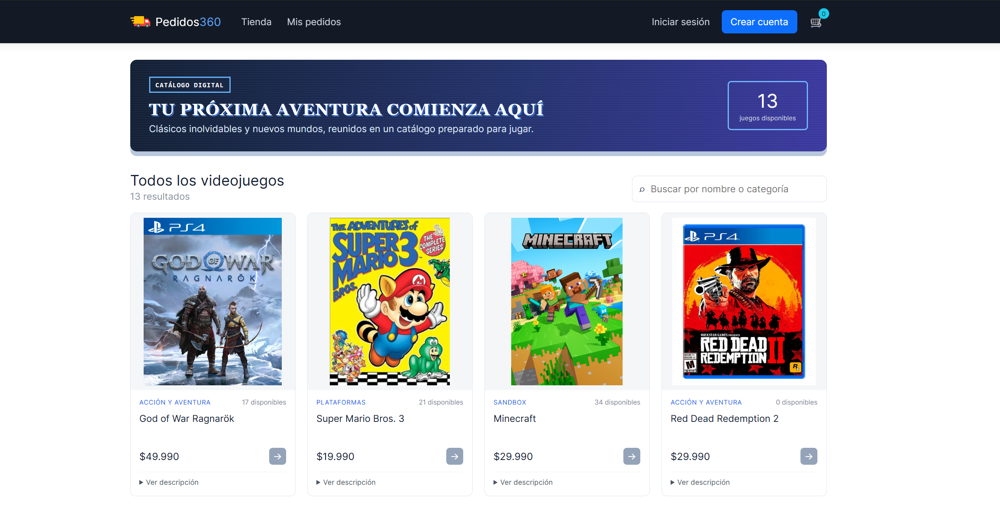
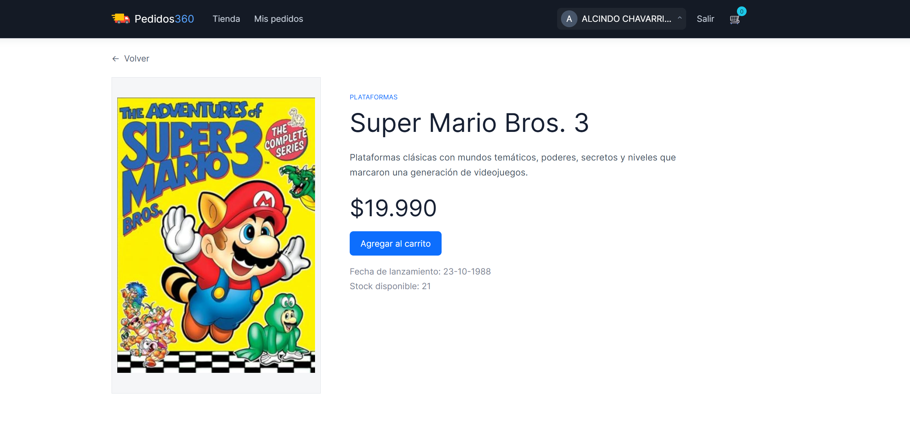
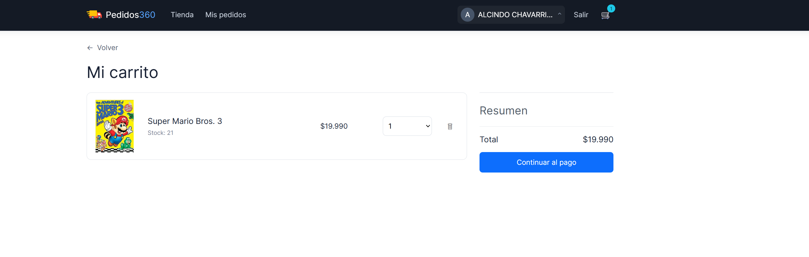
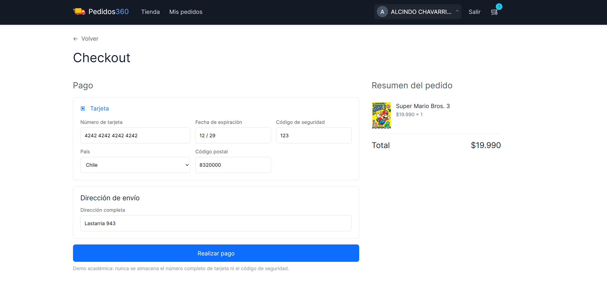
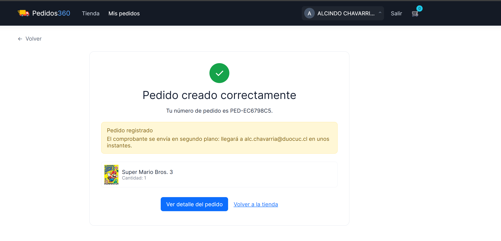
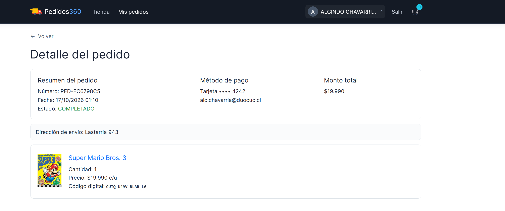

<div align="center">

# 🎮 Pedidos360

### Tienda digital de videojuegos · Arquitectura Cloud Native basada en microservicios

**Angular + Spring Boot + PostgreSQL + RabbitMQ + Apache Kafka + Docker Compose | Microsoft Azure + AWS EC2**

### 🎨 Frontend


### ⚙️ Backend y datos


### 🐇 Mensajería, contenedores y nube


</div>

---

## 📖 Descripción

**Pedidos360** es una tienda de videojuegos con frontend Angular, API Gateway y microservicios Spring Boot. Se ejecuta con **Docker Compose**, PostgreSQL, **RabbitMQ** (2 nodos) y **Kafka** (3 brokers + 1 ZooKeeper, sin KRaft).

- **RabbitMQ:** colas, exchanges `direct`/`topic`, reintentos y DLQ para flujos asíncronos.
- **Kafka:** eventos de pedidos, pagos y envíos, con productores y grupos consumidores.
- **Seguridad:** Spring Security, JWT y OAuth 2.0/OIDC; validar integraciones externas en el despliegue correspondiente.

## 🐳 Ejecución

Desde la carpeta raíz `Pedidos360` en **PowerShell**:

```powershell
docker compose down --volumes --rmi all --remove-orphans
docker compose up -d
docker compose ps
```

Para detener sin borrar los volúmenes: `docker compose down`. **No uses `down -v`** si necesitas conservar PostgreSQL, RabbitMQ o Kafka. Configura tu `.env` a partir de `.env.example`; no publiques credenciales.

| Acceso | URL local |
|---|---|
| Frontend Angular | http://localhost:4200 |
| API Gateway | http://localhost:8080 |
| Kafka UI | http://localhost:8088 |
| RabbitMQ Management | http://localhost:15672 |

Los microservicios usan puertos **internos de Docker** y no se exponen directamente por `localhost`.

## 🧩 Arquitectura

```text
Angular → API Gateway → microservicios Spring Boot → PostgreSQL
                           ├── RabbitMQ (2 nodos)
                           └── Kafka (3 brokers, 1 ZooKeeper)
                                   └── Kafka UI
```

| Componente | Función |
|---|---|
| `msvc-usuario`, `msvc-producto`, `msvc-carrito`, `msvc-catalogo` | Usuarios, productos, carrito y catálogo |
| `msvc-pago`, `msvc-envio` | Pedidos, pago simulado, envío y eventos |
| `msvc-rabbitmq-admin` | Administración de RabbitMQ |
| `kafka-init` | Crea/verifica los tópicos y **termina con `Exited (0)`**; no es un servicio caído |

**`kafka-init` no necesita puerto:** su única tarea es ejecutar `init-topics.sh`. Los brokers Kafka tampoco requieren puertos publicados al host para funcionar dentro de la red Docker.

## 📨 Apache Kafka

| Tópico | Particiones | Factor de réplica | Productor principal |
|---|---:|---:|---|
| `pedidos.eventos` | 3 | 3 | `msvc-pago` |
| `pagos.eventos` | 3 | 3 | `msvc-pago` |
| `envios.eventos` | 3 | 3 | `msvc-envio` |

**Consumidores existentes:** `catalogo-analitica` (`pedidos.eventos`) y `envio-analitica` (`pagos.eventos`). **Key** identifica el mensaje; **Value** contiene el JSON; **Headers** aporta metadatos de los eventos nuevos. En Kafka UI, **Messages** muestra eventos y **Consumers** muestra grupos, particiones y offsets.

### Comandos de verificación (PowerShell)

```powershell
# Tópicos
docker exec pedidos360-kafka-1-1 kafka-topics --bootstrap-server kafka-1:9092 --list

# Particiones, réplicas y líderes
docker exec pedidos360-kafka-1-1 kafka-topics --bootstrap-server kafka-1:9092 --describe --topic pedidos.eventos
docker exec pedidos360-kafka-1-1 kafka-topics --bootstrap-server kafka-1:9092 --describe --topic pagos.eventos
docker exec pedidos360-kafka-1-1 kafka-topics --bootstrap-server kafka-1:9092 --describe --topic envios.eventos

# Grupos de consumidores y lag
docker exec pedidos360-kafka-1-1 kafka-consumer-groups --bootstrap-server kafka-1:9092 --list
docker exec pedidos360-kafka-1-1 kafka-consumer-groups --bootstrap-server kafka-1:9092 --describe --group envio-analitica
docker exec pedidos360-kafka-1-1 kafka-consumer-groups --bootstrap-server kafka-1:9092 --describe --group catalogo-analitica
```

### Prueba de publicación sin el problema de `>>`

```powershell
powershell -ExecutionPolicy Bypass -File .\scripts\kafka-demo.ps1
```

Este script envía un mensaje con una **Key única** y un **Value JSON** utilizando `docker exec -i` (no `-it`), y cierra la entrada automáticamente. Para consultar el resultado: **Kafka UI → Topics → pedidos.eventos → Messages**, ordenado por mensajes recientes. El evento `PEDIDO_PRUEBA` es solo demostrativo, no una compra real.

Para leer eventos desde consola:

```powershell
docker exec pedidos360-kafka-1-1 kafka-console-consumer --bootstrap-server kafka-1:9092 --topic pedidos.eventos --from-beginning --max-messages 1 --property print.key=true --property print.partition=true --property print.offset=true
```

Para ver actividad real del backend:

```powershell
docker compose logs --tail 100 msvc-pago msvc-envio msvc-catalogo
```

**Nota:** si la consola muestra `>>`, PowerShell sigue esperando terminar una orden de varias líneas. Usa el script o copia los comandos de **una línea**. Un productor interactivo puede permanecer abierto esperando mensajes; `Ctrl+C` lo finaliza, no implica un fallo de Kafka.

### Statistics de Kafka UI

Muestra cantidad y distribución de mensajes por partición, offsets, fechas y tamaños de Key/Value. **No representa el Consumer Lag**, que se consulta en **Consumers**. Las 59 particiones del clúster incluyen las particiones del tópico interno `__consumer_offsets`; no deben eliminarse.

## ✅ Evidencia EA3

| Criterio | Estado verificado en capturas |
|---|---|
| Kafka: 3 brokers | ✅ Operativos |
| 3 tópicos, 3 particiones y réplica 3 | ✅ Confirmados por CLI |
| Consumer Groups y offsets | ✅ Grupos visibles, offsets procesados con lag 0 donde hay registros |
| Eventos Kafka | ✅ Se observan eventos de pedidos y pagos |
| Producer por consola | ✅ Prueba anterior interrumpida; utilizar `scripts/kafka-demo.ps1` |
| RabbitMQ 2 nodos | ✅ Contenedores activos; comprobar clustering en RabbitMQ Management |
| Integración frontend → backend → Kafka | ✅ Validar recorrido completo de compra |
| API Manager, IDaaS, OAuth/JWT | ✅ Validar en la plataforma cloud |
| Docker Compose en nube | ✅ Las capturas acreditan ejecución local, no cloud |

**Capturas recomendadas:** Kafka UI (Brokers, Topics, Messages y Consumers), RabbitMQ Management (Cluster/Exchanges/Queues), compra desde frontend y plataforma cloud.

---

## 📸 Capturas de pantalla

<div align="center">

### 🏠 1. Página principal de Pedidos360

Catálogo general de videojuegos, categorías, disponibilidad y buscador de productos.



### 🎮 2. Producto seleccionado

Vista detallada de un videojuego con descripción, precio, stock y opción de agregar al carrito.



### 🛒 3. Carrito de compras

Resumen de productos seleccionados, cantidades, precios y total de la compra.



### 💳 4. Checkout

Formulario de pago académico y dirección de envío, con resumen del pedido.



### ✅ 5. Pedido creado correctamente

Confirmación del pedido registrado y aviso de notificación por correo en segundo plano.



### 📦 6. Detalle del pedido

Información final de la compra: estado, método de pago, productos y código digital.



</div>

---

<div align="center">

**Pedidos360 · Desarrollo Cloud Native I · RabbitMQ + Apache Kafka**

*Proyecto académico de comercio electrónico con microservicios, mensajería asíncrona, contenedores y despliegue multicloud.*

</div>
